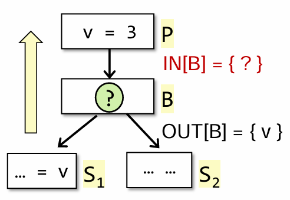

## 2026 软件工程学院 程序分析期末
>**仅供参考练习**
### 选择题
1.静态分析和运行测试的区别
2.大部分静态分析追求soundness
3.选出会导致安全风险的信息流
4.偏序关系三个性质
5.IR有的、AST没的性质
6.构造CG的精度最高的方法是（k-CFA）
7.CS-pta的3种上下文策略的精度、效率排序
8.不影响pta的结果的语句（break/continue）
9.datalog选出safe-rule
10.datalog概念，是声明式语言

### 填空题
1.AC3最多有（3）个操作数，（1）个操作符

2.数据流分析问题的转移函数具有（distributive）性质时，MOP算法精度与迭代算法相当；否则比较结果精度：（MOP的精度高于迭代算法的）
> distributive（分配性）指：转移函数（Transfer Function）对 Meet（或 Join）运算符满足分配律

3.活变量分析。如图，根据程序，已知OUT[B]。以下6种情况，分别求对应的IN[B]（空集填“空集”）

（1）k = n;
（2）k = v;
（3）v = 2;
（4）v = v - 1;
（5）v = 2; k = v;
（6）k = v; v = 2;

4.进行流敏感、上下文不敏感的ICP，OUT集使用行号区分，有OUT[3]={a=3,b=5}，求OUT[4]，OUT[6], OUT[10]
```c
void main() {
    a=3;
    b=5; // line 3
    c = foo(a, b); // line 4
    b = 8;
    c = foo(a, b); // line 6
    return;
}
int foo(int x, int y) {
    z = x + y; // line 10
    return z;
}
```

### 简答题
1.CS-pta的精度为什么高于CI-pta

2.补充表格：（右下方8个空）
|属性|...|活变量分析|可用表达式分析|
|:-:|:-:|:-:|:-:|
|May/Must|...|May|Must|
|Boundary|...|IN[exit]=$\Phi$|OUT[entry]=$\Phi$|
|Initiation|...|IN[B]=$\Phi$|OUT[B]=U|
|meet运算|...|$\cup$|$\cap$|

3.写出CI-pta的5个rule，对应New、Assign、Store、Load、Call

### 解答题
1.根据程序划分BB，写出CFG（答案只需要CFG）
```ir
(1)a...
(2)b...
(3)c...
(4)if c goto (7)
(5)d...
(6)e...
(7)f...
(8)g...
(9)h...
(10)if h goto (12)
(11)goto (3)
(12)return
```

2.根据程序写出CI-pta的PFG，PFG节点旁边需要标出指向object集合
```c
B b = new B()
a = b
c C = new C()
d = c
c.f = a
c.f = d
e = d.f
h = e
```

3.根据程序，使用CHA求CG
```java
Class A {
    static void main() {
        A.foo()
    }
    static void foo() {
        A a = new A()
        a.bar();
    }
    void bar() {
        C c = new C()
        c.bar()
    }
}
Class B extend A {
    void bar() {...}
}
Class C extend A {
    void bar() {
        if(...) {
            A.foo()
        }
    }
}
```
